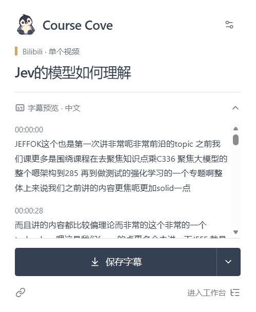
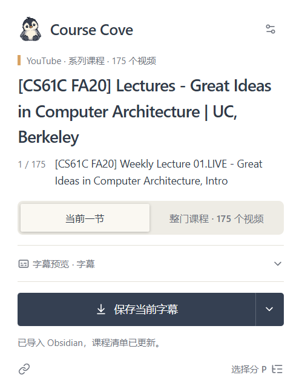
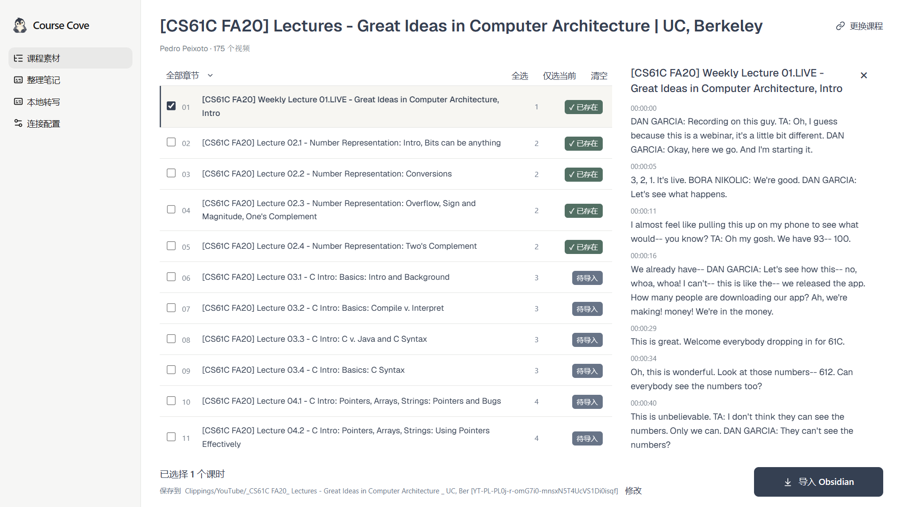

# Vid2Notes

把 B站和 YouTube 的课程字幕收进 Obsidian，再交给你使用的 AI 整理成学习笔记。

Vid2Notes 是面向课程学习的 Edge 扩展，支持单个视频、B站分 P 和 YouTube 播放列表。你可以预览字幕、按章节选择课时，导入笔记库，也可以直接复制字幕或保存 Markdown 文件。

当前版本：**v1.3.5**

[下载 Edge 安装包](./downloads/course-clipper-edge.zip) · [使用说明](./使用说明.md) · [本地转写安装包](./downloads/course-cove-asr-installer.zip)

## 功能

- **快捷采集**：在视频页打开扩展，识别当前课时并预览字幕，保存完整内容、来源信息和回看时间戳
- **复制与文件导出**：通过保存按钮右侧的菜单，将当前课时的完整字幕复制到剪贴板，或另存为 `.md` 文件
- **课程目录**：列出分 P 或播放列表视频，按标题识别章节，支持手动调整章节号、筛选和多选
- **批量导入**：在按钮中查看进度，再次点击取消，支持重试失败项；已有字幕文件自动跳过
- **整理笔记**：设置学习目标、语言、笔记目录、整理粒度、栏目和 YAML 属性，为所选课时生成任务指令
- **本地转写**：为无字幕视频转写音频并导入，安装向导提供 CPU 与 NVIDIA GPU 选项

工作台分为 **课程素材、整理笔记、本地转写、连接配置** 四个页面。

## 界面预览

| B站：当前视频字幕 | YouTube：系列课程 |
|:---:|:---:|
|  |  |

**课程工作台：选择课时、调整章节并核对字幕**



## 安装

1. 下载并解压 [Edge 安装包](./downloads/course-clipper-edge.zip)
2. 在 Edge 打开 `edge://extensions/`，开启“开发人员模式”
3. 点击“加载解压缩的扩展”，选择解压后的 **`course-clipper` 文件夹**
4. 将 Vid2Notes 固定到浏览器工具栏

安装包附有 `安装指南.html`。使用源码安装时，加载仓库中的 `extension/` 文件夹。

更新时，用新版文件替换原安装目录中的文件，再到扩展管理页点击“重新加载”。

## 使用

### 预览、复制与保存字幕

打开 B站或 YouTube 视频页，点击扩展图标。弹窗会读取当前视频，字幕预览展示前 12 个阅读段落。

- 点击 **保存字幕** 或 **保存当前字幕**，导入 Obsidian
- 点击保存按钮右侧的箭头，选择 **复制到剪贴板** 或 **保存文件…**，导出完整 Markdown 字幕
- 系列课程可以选择 **整门课程**，进入工作台处理

复制和文件导出可以直接使用。导入 Obsidian 时，先完成连接配置：

1. 在 Obsidian 安装并启用 [Local REST API](https://github.com/coddingtonbear/obsidian-local-rest-api) 插件，启用 HTTP 服务并复制 API Key
2. 点击扩展中的“连接 Obsidian”，或在工作台打开“连接配置”，填写服务地址、Key 和素材根目录；默认地址为 `http://127.0.0.1:27123`
3. 点击“测试连接”，成功后保存配置

### 导入整门课程

点击弹窗中的 **选择分 P** 或 **进入工作台**，打开课程素材页面。

1. 核对课程目录，勾选需要的课时
2. 调整章节号，按章节筛选或使用全选、仅选当前、清空
3. 点击课时标题展开字幕预览，确认内容与时间戳
4. 确认保存目录，点击 **导入 Obsidian**

导入按钮显示处理进度，导入中再次点击即可取消。失败项可以重试，无字幕课时可以使用本地转写。

快捷窗口收起后，当前视频的导入会继续。批量导入期间保持工作台和 Obsidian 打开；读取 YouTube 课程时保持浏览器可见，以便加载视频文稿。

### 整理学习笔记

导入素材后，勾选要整理的课时，打开 **整理笔记** 页面。

1. 设置学习目标、笔记语言、根目录和整理粒度
2. 调整笔记结构、各栏目的写法、署名、标签及属性，保存设置
3. 选择 **本地 AI agent**，下载或同步当前配置生成的技能，完成安装确认后复制简短任务指令
4. 使用 **网页 AI** 时，先导出实际字幕与规则，再上传材料并复制配套任务指令

可以按章节分组整理，也可以每个视频单独成篇。默认分组保留两级数字章节，如 `2.2`、`2.3`；同一 Lecture 的多个 Part 归入同一讲次，章节号可在课程目录中修改。

工作台根据你的设置生成 `course-notes` 技能，包含完整整理流程、任务方法和个人配置，支持整理、继续、补充、翻译与复习。Mermaid 和比例时间线另作为可选绘图技能维护，见[绘图技能说明](./learning-kit/README.md)。

### 为无字幕视频转写音频

1. 下载并解压 [本地转写安装包](./downloads/course-cove-asr-installer.zip)，运行 `install.cmd`，选择安装目录与 CPU / GPU 环境
2. 运行安装目录中的 `启动本地转写.cmd`
3. 在工作台的 **本地转写** 页面填写连接码，连接组件
4. 返回课程素材，选择无字幕课时，点击 **本地转写** 或 **本地转写并导入**

组件在本机运行，使用 faster-whisper small 模型。安装时下载约 461 MiB 的模型文件及运行环境，转写结果会标记来源。[组件说明](./asr/README.md)

## 素材保存

默认素材目录为 `Clippings/Bilibili/` 和 `Clippings/YouTube/`，可在连接配置或课程素材页面修改。每门课程有独立文件夹：

- **课程导入清单.md**：记录课时、章节、导入状态和字幕文件链接
- **原始字幕/**：保存每个视频的 Markdown 字幕、属性和回看时间戳；B站文件名包含 CID，YouTube 文件名包含视频 ID

同一课程目录中已有的字幕文件会跳过，课程清单随导入更新。整理后的笔记目录由“整理笔记”页面设置。

## 开发

直接在 Edge 加载 `extension/`。在项目根目录启动预览服务：

```sh
python -m http.server 8000 --bind 127.0.0.1
```

- [快捷窗口预览](http://127.0.0.1:8000/dev/preview.html)
- [工作台预览](http://127.0.0.1:8000/dev/workbench-preview.html)

预览直接加载当前分支的 `extension/` 源码，通过示例数据切换课程、无字幕、失败、导入和连接等状态。修改文件后点击“刷新预览”，预览不会写入 Obsidian。尚未定稿的改动在功能分支中开发，确认后合并到 `main`。

项目目录：

- `extension/popup/`：快捷窗口
- `extension/workbench/`：工作台外壳、课程目录、笔记配置、转写与连接页面
- `extension/background/`：平台读取、Obsidian 导入和本地转写消息
- `extension/shared/`：共用课程工具、字体和图标
- `dev/`：预览入口与模拟接口
- `asr/`：本地转写服务与安装向导
- `learning-kit/`：可选绘图技能
- `tests/`：功能测试
- `scripts/`：安装包构建脚本

运行 JavaScript 测试：

```sh
node --test tests/*.test.cjs
```

文件职责、整理规则来源和开发流程见[开发指南](./docs/开发指南.md)。准备发布时生成扩展、绘图技能和本地转写安装包：

```sh
python scripts/build_install_package.py
```

## 致谢与许可

本项目基于 [Bilibili-Obsidian-Clipper](https://github.com/haixiong1997/Bilibili-Obsidian-Clipper) 二次开发，保留原项目的 MIT 许可证与署名。

YouTube 字幕提取参考 [Obsidian Web Clipper](https://github.com/obsidianmd/obsidian-clipper) 和 [Defuddle](https://github.com/kepano/defuddle)。本地笔记库连接使用 [Obsidian Local REST API](https://github.com/coddingtonbear/obsidian-local-rest-api)。

项目采用 [MIT License](./LICENSE)。
