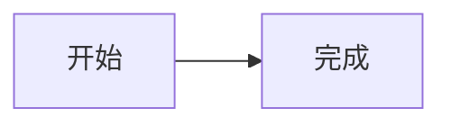

# Obsidian 与 Markdown 写作

生成或修订笔记时采用以下写法；栏目和属性仍由个人配置决定

## 加粗与标点

中文标签推荐把冒号、逗号等标点放在加粗范围之外，例如 `**声音/音素**：发音相似是一种关系`

加粗内容以标点结尾、结束标记后紧接汉字时，可能留下未解析的星号。标点需要留在加粗内时，在结束标记与后续文字之间留一个空格：

```md
**声音/音素：** 发音相似是一种关系
```

`**加粗**汉字` 的加粗内容没有以标点结尾，无需一律插入空格；`**加粗**，` 的后续标点也可以直接保留。检查加粗标记是否成对，结束标记前保持文字或标点紧邻，避免写成 `**声音/音素： **`

## 内联代码与代码围栏

正文只引用语法名称时写 `mermaid` 等名称，代码块的起止围栏放在独立行。需要展示含反引号的内联代码时，选用与内容中反引号段长度不同的成对分隔符，并用空格隔开紧邻边界的反引号

需要展示完整代码块语法时，使用外层更长的围栏。以下示例外层使用四个反引号，内部使用三个：

````md

````

交付成品直接使用 Markdown 正文。只有展示源码示例时才在外层加围栏，避免把整篇笔记包进代码块而使标题、公式与图表失去渲染

## 表格与数学公式

表格中的公式使用数学定界符，并将公式内的竖线换成 LaTeX 命令，避免被表格解析为分列符：

- 条件概率：`$P(A \mid B)$`
- 绝对值：`$\lvert X \rvert$`

行内公式使用 `$...$`，独立公式使用单独成行的 `$$` 定界符；公式放在代码块或行内代码中时只展示源码。表格中的普通文字竖线使用 `\|`，单元格中需要展示带竖线的 Wikilink 别名时也要转义分隔竖线

## YAML 属性与标签

启用属性时，将 YAML frontmatter 放在笔记开头，用成对的独立 `---` 行包围，采用 properties.md 指定的属性和类型

- 文字型章号、标识符及看似数字的文本使用引号，例如 `chapter: "2.10"`，保留编号形式
- 文字值包含冒号加空格、井号等 YAML 语法字符时使用引号；值内的引号按所选引号形式转义
- 数字和布尔值按类型写入，例如 `difficulty: 3`、`reviewed: false`；列表采用 YAML 列表，日期采用 `YYYY-MM-DD`
- 填写规则要求空值时使用 `null`；要求空文本时使用 `""`；要求省略时不输出该属性
- YAML 属性中的 Obsidian 内部链接使用带引号的字符串，例如 `"[[术语表]]"`
- Obsidian 标签不含空格，多词用连字符连接，例如 `computer-network`；YAML 的 tags 列表写标签名，不加正文标签的井号前缀

## 链接与附件

本地笔记中的内部链接和附件路径对应笔记库内实际存在的文件；Obsidian 可使用 Wikilink 或 Markdown 链接。Markdown 链接的路径包含空格时使用 `%20` 或用尖括号包围路径

网页交付优先使用通用 Markdown 链接及实际来源 URL。引用随成品交付的附件时采用相对路径并说明文件名，笔记目录仅作为保存建议。回看链接采用素材中已确认的视频标识与时间

## 段落与结构

标题使用清晰的层级，标题、列表、引用块、表格及代码块与相邻正文之间留空行；嵌套列表和列表内代码块按所属条目正确缩进

段落之间使用空行，按语义组织正文，避免把每句字幕分别写成一段。引用块用于教师原话，代码块用于源码；中文关系图采用表格、Mermaid 或图片，避免 ASCII 框线图
